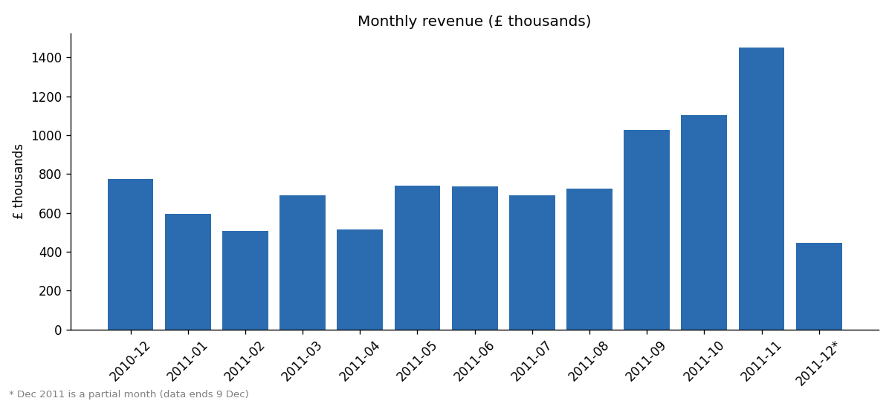
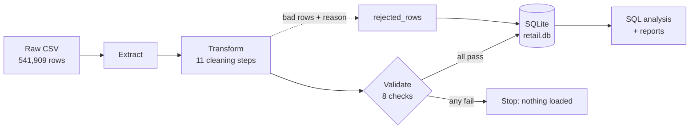

# Online Retail Data Cleaning Pipeline

I built this to practise the part of data engineering that usually takes the most time: getting messy data into a state you can trust. The pipeline takes 541,909 real transactions from a UK online shop, cleans them, checks the result, loads it into SQLite and answers business questions with SQL.

Built with Python, pandas, SQLite, matplotlib and pytest.



## The data and what was wrong with it

The data is the public [UCI Online Retail dataset](https://archive.ics.uci.edu/dataset/352/online+retail): every sale a UK gift shop made online between December 2010 and December 2011. Before writing any cleaning code, I went through it in a notebook ([`notebooks/exploration.ipynb`](notebooks/exploration.ipynb)) and listed every problem I could find. This is what the pipeline does about each one:

| Problem | How many | What I did |
| --- | ---: | --- |
| Cancelled orders mixed in with sales (invoice number starts with `C`) | 9,251 | Rejected |
| Exact duplicate rows | 5,270 | Rejected |
| Lines that aren't products: postage, bank charges, Amazon fees, manual adjustments, gift vouchers | 2,361 | Rejected |
| Quantity of zero or less | 1,239 | Rejected |
| Price of zero or less (stock write-offs such as "damaged" and "found") | 1,143 | Rejected |
| No product name, and no other row to recover it from | 110 | Rejected |
| Impossible quantities, like 80,995 of one item on a single line | 2 | Rejected |
| Product names with stray spaces | 113,452 | Trimmed |
| One stock code with several names (typos, old wording) | 650 codes | Gave each code its most common name |
| Lower-case stock codes (`85123a` next to `85123A`) | 1,977 | Upper-cased |
| Unclear country names (`EIRE`, `RSA`, `USA`, `Unspecified`) | 4 names | Renamed |
| Missing customer ID | 131,387 rows | Kept, with a flag |

That leaves 522,533 clean rows (96.4%) and 19,376 rejected ones. Nothing is thrown away: every raw row ends up in either the clean table or the rejected table, with a reason attached.

## How it works



`python run_pipeline.py` runs five steps in order:

1. **Extract** ([`pipeline/extract.py`](pipeline/extract.py)) downloads the CSV the first time and reads the ID columns as text, so `C536379` keeps its `C` and customer `17850` doesn't turn into `17850.0`.
2. **Transform** ([`pipeline/transform.py`](pipeline/transform.py)) runs 11 small cleaning steps. Each one fixes a single problem and logs how many rows it removed.
3. **Validate** ([`pipeline/validate.py`](pipeline/validate.py)) runs 8 checks on the cleaned data. If any of them fails, the pipeline stops and nothing gets loaded.
4. **Load** ([`pipeline/load.py`](pipeline/load.py), [`sql/schema.sql`](sql/schema.sql)) creates three tables, each with its own primary key, and loads the clean rows, the rejected rows and the step log.
5. **Report** ([`pipeline/report.py`](pipeline/report.py), [`sql/analysis.sql`](sql/analysis.sql)) runs 9 SQL queries and writes the results and the chart to [`reports/`](reports/).

## Decisions worth explaining

**Rejected rows are kept, not deleted.** They go into a `rejected_rows` table with a reason such as `cancelled_order` or `duplicate_row`. If someone asks why 19,376 rows are missing, the answer is one query away.

**Sales with no customer ID stay in.** 131,387 rows have no customer ID, probably guest checkouts, but the sales still happened. Dropping them would have hidden about £1.5M of revenue. They count towards revenue and are left out only when a question is about customers.

**The order of the cleaning steps matters, and validation is how I found out.** In my first version, duplicates were removed before product names were standardised. Validation then failed with 2 duplicate rows. Order 554084 had the same line twice, once as "BUNTING , SPOTTY" and once as "SPOTTY BUNTING". The two rows only became identical after the names were fixed, by which point the duplicate step had already run. Standardising names first fixed it.

**Each table has a surrogate primary key.** `invoice_no` can't be the key because one invoice has many lines, and even invoice plus product repeats when someone adds the same item to an order twice. So each table gets its own counter (`sale_id`, `rejected_id`, `log_id`), which SQLite fills in as the rows are loaded.

**It's safe to run again.** The database is rebuilt from scratch on every run, so running the pipeline twice gives the same result instead of loading everything twice.

## What the data shows

The full query results are in [`reports/analysis_results.md`](reports/analysis_results.md), and the cleaning summary is in [`reports/data_quality_report.md`](reports/data_quality_report.md).

- Revenue for the year was £10.0M, from 19,771 orders placed by 4,333 customers across 3,797 products.
- September to November brought in 36% of the year's revenue. November alone was £1.45M.
- Repeat customers matter most: 2,828 of them account for 94% of the revenue from customers with an ID.
- The best-selling product by revenue is the Regency Cakestand 3 Tier, at £174K.
- Outside the UK, the biggest market is the Netherlands (£284K), followed by Ireland and Germany.
- There isn't a single Saturday order in the whole year, so the shop presumably doesn't process orders on Saturdays.

## Database tables

| Table | Rows | What's in it |
| --- | ---: | --- |
| `sales` | 522,533 | Clean sales lines, plus `line_total`, `invoice_month`, `day_of_week` and `hour` |
| `rejected_rows` | 19,376 | Every removed row and the reason it was removed |
| `pipeline_log` | 11 | Row counts before and after each cleaning step |

## Running it yourself

```bash
git clone https://github.com/SanketChuri/Online-Retail-Data-Cleaning-Pipeline.git
cd Online-Retail-Data-Cleaning-Pipeline
python -m venv venv
source venv/bin/activate        # on Windows: venv\Scripts\activate
pip install -r requirements.txt

python run_pipeline.py          # downloads the data (about 45 MB) and runs everything in roughly 15 seconds
pytest                          # runs the unit tests
```

After that you can open `data/retail.db` in any SQLite tool, or query it from the terminal:

```bash
sqlite3 data/retail.db "SELECT country, ROUND(SUM(line_total)) FROM sales GROUP BY country ORDER BY 2 DESC LIMIT 5;"
```

## Project structure

```
├── run_pipeline.py          # runs all 5 steps in order
├── pipeline/
│   ├── config.py            # file paths and cleaning rules in one place
│   ├── extract.py
│   ├── transform.py
│   ├── validate.py
│   ├── load.py
│   └── report.py
├── sql/
│   ├── schema.sql           # table definitions
│   └── analysis.sql         # business questions
├── notebooks/
│   └── exploration.ipynb    # where I first looked at the raw data
├── reports/                 # generated results, committed so they show on GitHub
├── tests/
│   └── test_transform.py    # tests the cleaning on a small hand-made messy dataset
└── data/                    # created when you run it, not committed
```

## What I'd add next

- A daily schedule (cron or Airflow) so new data gets processed automatically
- PostgreSQL instead of SQLite
- Database rules (`NOT NULL`, `CHECK`) and indexes for faster queries
- Separate `invoices`, `products` and `customers` tables instead of one wide `sales` table
