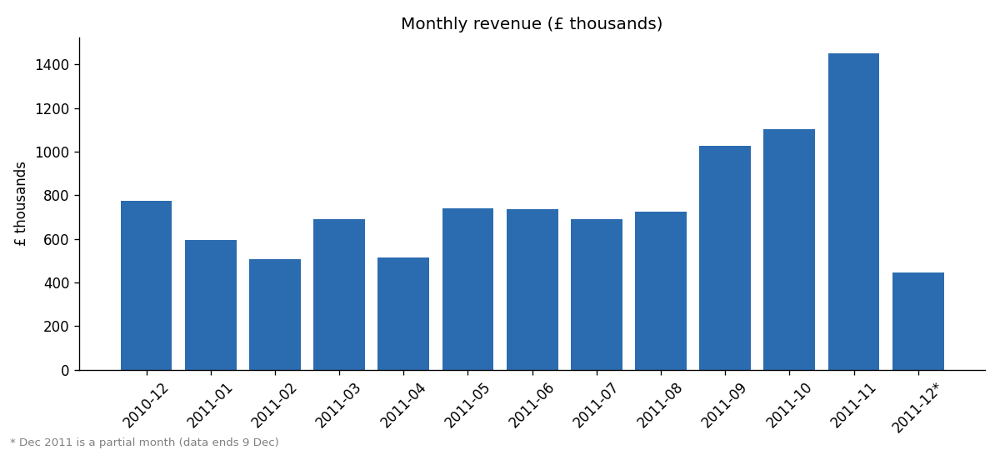

# Analysis Results

## Overall summary

| total_orders | total_customers | total_products | total_revenue_gbp |
| --- | --- | --- | --- |
| 19,771 | 4,333 | 3,797 | 10,001,014.27 |

## Revenue by month

| invoice_month | orders | revenue_gbp |
| --- | --- | --- |
| 2010-12 | 1,550 | 775,638.36 |
| 2011-01 | 1,080 | 593,196.64 |
| 2011-02 | 1,093 | 507,799.87 |
| 2011-03 | 1,440 | 689,833.51 |
| 2011-04 | 1,235 | 515,377.99 |
| 2011-05 | 1,668 | 739,938.15 |
| 2011-06 | 1,525 | 737,558.98 |
| 2011-07 | 1,452 | 688,219.34 |
| 2011-08 | 1,339 | 724,216.50 |
| 2011-09 | 1,818 | 1,028,320.38 |
| 2011-10 | 2,005 | 1,103,314.25 |
| 2011-11 | 2,751 | 1,451,578.98 |
| 2011-12 | 815 | 446,021.32 |

## Top 10 products by revenue

| stock_code | description | units_sold | revenue_gbp |
| --- | --- | --- | --- |
| 22423 | REGENCY CAKESTAND 3 TIER | 13,851 | 174,156.54 |
| 85123A | WHITE HANGING HEART T-LIGHT HOLDER | 37,933 | 106,415.23 |
| 47566 | PARTY BUNTING | 18,283 | 99,445.23 |
| 85099B | JUMBO BAG RED RETROSPOT | 48,371 | 94,159.81 |
| 23084 | RABBIT NIGHT LIGHT | 30,739 | 66,870.03 |
| 22086 | PAPER CHAIN KIT 50'S CHRISTMAS | 19,329 | 64,875.59 |
| 84879 | ASSORTED COLOUR BIRD ORNAMENT | 36,362 | 58,927.62 |
| 79321 | CHILLI LIGHTS | 10,302 | 54,096.36 |
| 22502 | PICNIC BASKET WICKER SMALL | 1,937 | 51,408.77 |
| 22197 | POPCORN HOLDER | 56,898 | 51,334.47 |

## Top 10 countries by revenue (excluding UK)

| country | orders | revenue_gbp |
| --- | --- | --- |
| Netherlands | 93 | 283,889.34 |
| Ireland | 282 | 270,850.86 |
| Germany | 443 | 205,381.15 |
| France | 382 | 184,493.00 |
| Australia | 56 | 138,103.81 |
| Spain | 88 | 55,706.56 |
| Switzerland | 50 | 53,065.60 |
| Japan | 19 | 37,416.37 |
| Belgium | 98 | 36,927.34 |
| Sweden | 34 | 36,828.83 |

## Average order value by month

| invoice_month | avg_order_value_gbp |
| --- | --- |
| 2010-12 | 500.41 |
| 2011-01 | 549.26 |
| 2011-02 | 464.59 |
| 2011-03 | 479.05 |
| 2011-04 | 417.31 |
| 2011-05 | 443.61 |
| 2011-06 | 483.65 |
| 2011-07 | 473.98 |
| 2011-08 | 540.86 |
| 2011-09 | 565.63 |
| 2011-10 | 550.28 |
| 2011-11 | 527.66 |
| 2011-12 | 547.27 |

## Top 10 customers by spend

| customer_id | country | orders | total_spent_gbp |
| --- | --- | --- | --- |
| 14646 | Netherlands | 72 | 279,138.02 |
| 18102 | United Kingdom | 60 | 259,657.30 |
| 17450 | United Kingdom | 46 | 194,390.79 |
| 14911 | Ireland | 198 | 136,161.83 |
| 12415 | Australia | 20 | 124,564.53 |
| 14156 | Ireland | 54 | 116,560.08 |
| 17511 | United Kingdom | 31 | 91,062.38 |
| 16029 | United Kingdom | 62 | 72,708.09 |
| 16684 | United Kingdom | 28 | 66,653.56 |
| 13694 | United Kingdom | 50 | 65,039.62 |

## Busiest days of the week

| day_of_week | orders | revenue_gbp |
| --- | --- | --- |
| Thursday | 4,209 | 2,131,596.38 |
| Wednesday | 3,667 | 1,781,811.34 |
| Tuesday | 3,508 | 2,007,831.72 |
| Friday | 3,108 | 1,598,617.66 |
| Monday | 3,076 | 1,682,860.52 |
| Sunday | 2,203 | 798,296.65 |

## Repeat vs one-time customers

| customer_type | customers | revenue_gbp |
| --- | --- | --- |
| One-time | 1,505 | 549,425.20 |
| Repeat | 2,828 | 7,941,597.39 |

## Why rows were rejected

| reject_reason | rows_rejected |
| --- | --- |
| cancelled_order | 9,251 |
| duplicate_row | 5,270 |
| non_product_code | 2,361 |
| quantity_not_positive | 1,239 |
| price_not_positive | 1,143 |
| missing_description | 110 |
| extreme_quantity | 2 |
